# SmartClass — Database Architecture (Prompt 02 / M2)

**Engine:** Supabase PostgreSQL (verified on PostgreSQL 18 via PGlite in tests).
**Migrations:** `supabase/migrations/` (ordered). Dev seed: `supabase/seed.sql` (never production).
**Precedence:** individual Level 1–12 text wins (Part B).

## Migration order

| File | Domain |
|---|---|
| `…0001_foundation.sql` | domains (`sha256_hex`, `git_commit_sha`), append-only trigger |
| `…0002_institution_identity.sql` | A institution, B identity (schools, rooms, class_sessions, students, cards, embeddings, consent, guardian links) |
| `…0003_devices_telemetry.sql` | C devices, credentials, config (+monotonic revision), inbox, telemetry, events, health |
| `…0004_operations_safety.sql` | D commands/OTA, E incidents/blocks/notifications/login/audit, private-snapshot + storage-deletion bookkeeping |
| `…0005_vision_ml_weather_competition.sql` | F vision, G ML/CSI, H weather, I competition evidence |
| `…0006_attendance_checkins.sql` | attendance records + card check-in log |
| `…0007_functions.sql` | transactional functions (ack, attendance, mismatch/block, threshold, delete_student) |
| `…0008_rls.sql` | RLS: default-deny on all tables, scope helpers, read policies |
| `…0009_realtime_storage.sql` | scoped Realtime publication + private buckets |

## ERD (core relationships)

```mermaid
erDiagram
  schools ||--o{ rooms : has
  schools ||--o{ user_roles : grants
  schools ||--o{ students : enrolls
  rooms ||--o{ room_memberships : "teacher assigned"
  rooms ||--o{ class_sessions : schedules
  rooms ||--o{ devices : installed
  class_sessions ||--o{ class_enrollments : lists
  class_sessions ||--o{ attendance_records : produces
  students ||--o{ class_enrollments : in
  students ||--o| student_cards : "active card"
  students ||--o{ face_embeddings : biometrics
  students ||--o{ consent_records : consent
  students ||--o{ guardian_student_links : "linked guardian"
  students ||--o{ attendance_records : marked
  devices ||--|| device_configurations : desired
  devices ||--o{ device_credentials : "token hash"
  devices ||--o{ device_message_inbox : "raw (device_id,seq)"
  device_message_inbox ||--o| telemetry_readings : normalizes
  device_message_inbox ||--o| device_events : normalizes
  devices ||--o{ device_events : emits
  devices ||--o{ device_commands : receives
  device_commands ||--o{ command_acknowledgements : acked
  devices ||--o{ ota_jobs : updates
  ota_releases ||--o{ ota_jobs : installs
  rooms ||--o{ security_incidents : raises
  security_incidents ||--o| incident_acknowledgements : "one ack"
  security_incidents ||--o{ blocked_cards : triggers
  rooms ||--o{ card_checkins : logs
  attendance_records ||--o{ card_checkins : links
  rooms ||--o{ occupancy_events : counts
  rooms ||--o{ camera_health_events : health
  rooms ||--o{ handraise_events : raises
  rooms ||--o{ presence_events : presence
  rooms ||--o{ csi_predictions : zones
  model_runs ||--o{ model_metrics : evaluated
  competition_levels ||--o{ level_test_runs : attempts
  level_test_runs ||--o{ level_test_results : requirements
```



## Key integrity rules (mandates 1–12)

- **Idempotency.** `device_message_inbox (device_id, seq)` unique; `telemetry_readings`/`device_events` carry the same unique key. Device events keep `seq`; server events have `source='SERVER'` and no `seq` (paper §6 split).
- **Attendance.** `attendance_records (class_session_id, student_id)` unique; `record_attendance()` inserts once, repeat tap returns the existing id.
- **Atomic Ack.** `incident_acknowledgements.incident_id` is the PK; `ack_incident()` uses `ON CONFLICT DO NOTHING` → exactly one winner.
- **Card mapping.** one `ACTIVE` card per student and per UID (partial unique indexes); block via `register_face_mismatch()` (3 in 2 min → 5 min), expiry honoured by `is_card_blocked()`.
- **Config revision** monotonic (trigger); desired vs `applied_revision` separated; `warning < danger` + `0–50 °C` checks; `apply_threshold_change()` bumps revision + writes `device_config_history` (append-only).
- **Time.** `device_ts` (source) and `received_at` (server) stored separately everywhere.
- **Private media.** object keys only (`private_snapshots`), never public URLs; retention in `retention_policies`; deletions go through `storage_deletion_queue` with retry.
- **Biometrics.** `face_embeddings` server-only (no client grant); enrollment photos transient (bucket `enrollment-temp`); `delete_student()` cascades embeddings/cards/consent/snapshots, queues object deletes, keeps an audit row.
- **Indexes** on room/time, device/time, attendance, card/time, notification recipient, login history (see each migration).

## RLS policy matrix (SELECT; writes are server-side via service_role + RPC)

| Table group | Admin | Teacher | Student | Guardian |
|---|---|---|---|---|
| rooms, class_sessions, devices, telemetry, device_events, health, vision/CSI/occupancy | school | assigned room | — | — |
| attendance_records | room | room | own only | linked child |
| students, student_cards, consent | school | enrolled-in-their-room | self | linked child |
| security_incidents, card_checkins, private_snapshots | room | room | — | — |
| device_commands, ota_releases, ota_jobs, command_acks | school | — | — | — |
| login_attempts, audit_logs | school | — | — | — |
| notifications | recipient-only (any role) | | | |
| weather_cache/notices, competition_levels | all members | all members | weather: members | weather: members |
| face_embeddings, device_credentials, csi_labelled_samples, storage queue, deliveries | server-only (no client grant) | | | |

Default deny: RLS is enabled on **every** public table; only the grants + policies above open specific reads.

## Test commands

```
npm test                 # all suites (contract + ingestion + db)
npx vitest run tests/db  # migrations, constraints, functions, RLS (PGlite, in-memory PG18)
```

The DB harness (`tests/db/harness.ts`) shims `auth.users` + `auth.uid()` and the `authenticated`/`service_role` roles, runs every migration, then seeds, so tests exercise real RLS with role switching. No Docker required.
